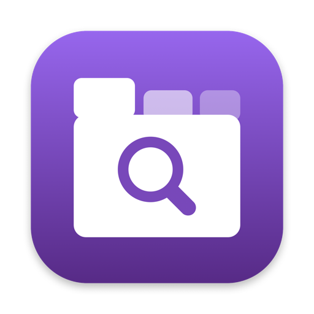

<div align="center">



# Browvitab

**Every open browser tab, one keystroke away in Alfred 6.**

[](https://github.com/chmouel/alfred-browvitab/actions/workflows/ci.yml)
[](https://github.com/chmouel/alfred-browvitab/releases/latest)
[](https://github.com/chmouel/alfred-browvitab/releases)
[](https://www.alfredapp.com/powerpack/)
[](#get-started)
[](#get-started)
[](#get-started)
[](workflow/tabs.alfredui/lib/browvitab)
[](LICENSE)


</div>

Browvitab lists the tabs of Firefox, Chrome, Brave and the other Chromium
browsers you run, in a single native Alfred window. Type a few letters of a
title or a site, press <kbd>↩</kbd>, and you land on that tab in the right
window, even with several Firefox profiles open.

## Highlights

- All your browsers in one list. Pinned tabs come first, and the tab you were
  on before the current one sits at the top, so <kbd>↩</kbd> right after
  opening takes you back to it.
- A native Alfred 6 window: it filters as you type, follows your Alfred theme
  and light or dark mode, and has a right-click and <kbd>⌘</kbd><kbd>K</kbd>
  actions menu.
- The list keeps up while it is open. Open, close or rename a tab and the row
  changes in place.
- <kbd>⌃</kbd><kbd>↩</kbd> closes a tab and moves to the next one, so you can
  clear out a pile of tabs without leaving Alfred.
- Site icons come from your browsers' own caches. Nothing goes over the
  network.
- The `tabl` keyword shows the same tabs in Alfred's classic result list.

## How it compares

Other tab workflows each cover one browser family. Browvitab puts Firefox and
the Chromium browsers in the same list.

| | Browvitab | [Browser Tabs](https://alfred.app/workflows/epilande/browser-tabs/) | [Firefox Assistant](https://github.com/deanishe/alfred-firefox) | [Safari Tools](https://alfred.app/workflows/alfredapp/safari-tools/) | [Arc Tabs and Spaces](https://alfred.app/workflows/caicailiushui/arc-tabs-and-spaces/) |
| --- | :---: | :---: | :---: | :---: | :---: |
| Firefox (and Zen, LibreWolf, Floorp) | ✅ | | ✅ | | |
| Chrome, Brave, Edge, Vivaldi | ✅ | ✅ | | | |
| Safari | | ✅ | | ✅ | |
| Arc | | ✅ | | | ✅ |
| All browsers in one list | ✅ | one keyword per browser | | | |
| Several Firefox profiles kept apart | ✅ | | | | |
| Close tabs | ✅ | | ✅ | | |
| List refreshes while open | ✅ | | | | |
| Native Alfred 6 window | ✅ | | | | |
| Bookmarks and history | | | ✅ | ✅ | |
| Browser extension | Vicinae | | its own | | |

Browser Tabs and Safari Tools talk to browsers through AppleScript, which
Firefox does not support. Browvitab uses the open source
[Vicinae browser extension](https://docs.vicinae.com/browser-extension), so
Firefox works as well as Chrome. If you live in Safari or Arc, pick one of the
others.

## Get started

You need Alfred 6 with the [Powerpack](https://www.alfredapp.com/powerpack/)
and Python 3.9 or later. If your Mac has no Python 3, the window says so and
offers Apple's Command Line Tools installer.

1. Download
   [**Browvitab.alfredworkflow**](https://github.com/chmouel/alfred-browvitab/releases/latest/download/Browvitab.alfredworkflow)
   and double-click it.
2. Type `tabs` in Alfred.

The first time, the window shows a short checklist instead of tabs. Press
<kbd>↩</kbd> to take the next step, or use the buttons:

- add the Vicinae extension to a browser (the button opens its store page in
  that browser),
- connect your browsers,
- wait for the extension to pick up the connection. It checks about once a
  minute; turning the extension off and on skips the wait.

Each step ticks itself off, and your tabs replace the checklist as soon as the
first browser connects. Run `tabs:setup` to see the checklist again later.

> [!NOTE]
> The extension talks to one program at a time. If a browser already sends its
> tabs to Vicinae, the checklist says so and offers a *Use Browvitab* button.
> Nothing changes until you confirm.

To install from a clone of the repository instead, run `./install.sh`.

## Usage

Search the tabs of every connected browser via the `tabs` keyword.


| Key | Action |
| --- | --- |
| <kbd>↩</kbd> or double-click | Switch to the tab and bring its window forward |
| <kbd>⌘</kbd><kbd>↩</kbd> | Copy the URL |
| <kbd>⌃</kbd><kbd>↩</kbd> | Close the tab, keep the list open |
| <kbd>⌘</kbd><kbd>K</kbd> or right-click | Copy the title or a Markdown link, and more |
| <kbd>↑</kbd> <kbd>↓</kbd>, <kbd>⌘</kbd><kbd>↑</kbd> <kbd>⌘</kbd><kbd>↓</kbd> | Move, jump to the top or bottom |
| <kbd>⎋</kbd> | Back to Alfred; <kbd>⌘</kbd><kbd>⎋</kbd> closes it |

The search matches titles, site names and words in the address, in any
order: `pipe pull` finds a pull request on `github.com/…/pipelines-as-code`.
Pasting a full URL brings up the tabs from that site, and `tabs github` opens
the window already filtered.

## Open it from a keybinding

The workflow's Hotkey is <kbd>⌥</kbd><kbd>⌘</kbd><kbd>T</kbd> out of the box.
Change it in Alfred Preferences, Workflows, Browvitab.

Other tools (skhd, Hammerspoon, Karabiner, a Stream Deck, a shell alias) can
open it through its external trigger, with or without a search:

```sh
open "alfred://runtrigger/com.chmouel.alfred-browvitab/tabs/?argument=github"

osascript -e 'tell application id "com.runningwithcrayons.Alfred" to run trigger "tabs" in workflow "com.chmouel.alfred-browvitab" with argument "github"'
```

<details>
<summary>skhd, Hammerspoon and Karabiner examples</summary>

[skhd](https://github.com/koekeishiya/skhd), in `~/.skhdrc`:

```sh
ctrl + alt - t : open "alfred://runtrigger/com.chmouel.alfred-browvitab/tabs/"
```

[Hammerspoon](https://www.hammerspoon.org), in `~/.hammerspoon/init.lua`:

```lua
hs.hotkey.bind({ "ctrl", "alt" }, "t", function()
  hs.urlevent.openURL("alfred://runtrigger/com.chmouel.alfred-browvitab/tabs/")
end)
```

[Karabiner-Elements](https://karabiner-elements.pqrs.org), as a complex modification:

```json
{
  "description": "Hyper+T opens Browvitab",
  "manipulators": [{
    "type": "basic",
    "from": { "key_code": "t", "modifiers": { "mandatory": ["command", "control", "option", "shift"] } },
    "to": [{ "shell_command": "open 'alfred://runtrigger/com.chmouel.alfred-browvitab/tabs/'" }]
  }]
}
```

</details>

Alfred asks once before another app may open an `alfred://` link.

## Configuration

In Alfred Preferences, open Browvitab and click *Configure Workflow* to change
the `tabs` and `tabl` keywords, or to switch the buttons to the macOS 26 glass
look.

## Troubleshooting

`tabs:setup` shows where each browser stands. From a terminal,

```sh
~/Library/Application\ Support/browvitab/bin/browvitab status
```

prints the same with file paths, plus every connected browser and its tab
count.

If something still looks wrong, `touch /tmp/browvitab-$(id -u)/trace` makes
every action log to that file. Open an issue with its contents.

## Uninstall

```sh
./uninstall.sh             # disconnect the browsers, remove the installed copy and caches
./uninstall.sh --workflow  # also delete the workflow from Alfred
```

Browvitab only removes what it installed. If you use Vicinae, restart it to
hand the browsers back.

## How it works

Each browser starts a small helper when the extension loads. The helper keeps
that browser's tab list and answers Alfred over a private local socket, so
nothing polls your browsers. [docs/ARCHITECTURE.md](docs/ARCHITECTURE.md)
covers the Alfred UI, the live refresh and the macOS details.

## License

[Apache License 2.0](LICENSE). See [NOTICE](NOTICE) for third-party code.
Alfred is a trademark of Running with Crayons Ltd.
