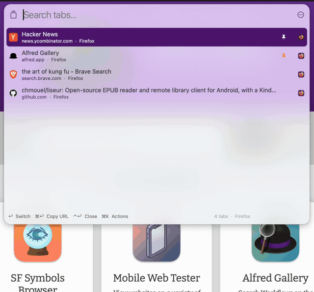
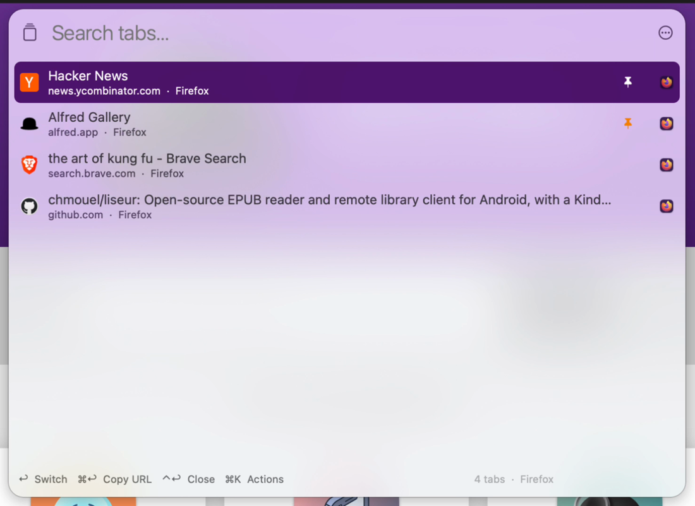

<div align="center">


# Browvitab

**Every open browser tab, one keystroke away in Alfred 6.**

[](https://github.com/chmouel/alfred-browvitab/actions/workflows/ci.yml)
[](https://github.com/chmouel/alfred-browvitab/releases/latest)
[](https://github.com/chmouel/alfred-browvitab/releases)
[](https://www.alfredapp.com/powerpack/)
[](#requirements)
[](#connect-your-browsers)
[](#connect-your-browsers)
[](src/)
[](LICENSE)



</div>

Browvitab lists the tabs of Firefox, Chrome, Brave and the other Chromium
browsers you run, in a single native Alfred window. Type a few letters of a
title or a site, press <kbd>↩</kbd>, and you land on that tab in the right
window, even with several Firefox profiles open.

## Highlights

- One list for all your browsers. Pinned tabs sit at the top, and the tab you
  were on before the current one comes first, so <kbd>↩</kbd> right after
  opening flips back to it.
- Built on Alfred 6's new native UI: instant filtering as you type, a right-click
  and <kbd>⌘</kbd><kbd>K</kbd> actions menu, theme colours and light or dark mode.
- The list updates while it is open. Open, close or rename a tab in the browser
  and the row appears or changes without reopening Alfred.
- Close tabs from the list with <kbd>⌃</kbd><kbd>↩</kbd> and keep going; the
  next tab is selected for you.
- Site icons come from your browsers' own caches. Nothing is downloaded and no
  tab ever leaves your Mac.
- The `tabl` keyword shows the same tabs in Alfred's classic result list.

## How it compares

Other tab workflows each cover one browser family. Browvitab puts Firefox and
the Chromium browsers in the same list.

| | Browvitab | [Browser Tabs](https://alfred.app/workflows/epilande/browser-tabs/) | [Firefox Assistant](https://github.com/deanishe/alfred-firefox) | [Safari Tools](https://alfred.app/workflows/alfredapp/safari-tools/) | [Arc Tabs and Spaces](https://alfred.app/workflows/caicailiushui/arc-tabs-and-spaces/) |
| --- | :---: | :---: | :---: | :---: | :---: |
| Firefox (and Zen, LibreWolf, Floorp) | ✅ | | ✅ | | |
| Chrome, Brave, Edge, Vivaldi | ✅ | ✅ | | | |
| Safari | | ✅ | | ✅ | |
| Arc | | ✅ | | | ✅ |
| All browsers in one list | ✅ | one keyword per browser | | | |
| Several Firefox profiles kept apart | ✅ | | | | |
| Close tabs | ✅ | | ✅ | | |
| List refreshes while open | ✅ | | | | |
| Native Alfred 6 UI | ✅ | | | | |
| Bookmarks and history | | | ✅ | ✅ | |
| Needs a browser extension | Vicinae | | its own | | |

Browser Tabs and Safari Tools talk to browsers through AppleScript, which
Firefox does not support. Browvitab uses the open source
[Vicinae browser extension](https://docs.vicinae.com/browser-extension)
instead, so Firefox works as well as Chrome. If you live in Safari or Arc,
pick one of the others.

## Requirements

- macOS with Alfred 6 installed
- [Alfred 6](https://www.alfredapp.com) with the
  [Powerpack](https://www.alfredapp.com/powerpack/)
- The Vicinae extension in at least one browser

## Install

Download
[**Browvitab.alfredworkflow**](https://github.com/chmouel/alfred-browvitab/releases/latest/download/Browvitab.alfredworkflow)
and double-click it to import it into Alfred.

To build it yourself you need Rust (`brew install rust`):

```sh
git clone https://github.com/chmouel/alfred-browvitab
cd alfred-browvitab
./install.sh
```

`install.sh` builds the workflow, connects your browsers and opens the
workflow in Alfred for import.

## Connect your browsers

1. Add the Vicinae extension to your browser:
   [Firefox](https://addons.mozilla.org/firefox/addon/vicinae/) or
   [Chrome Web Store](https://chromewebstore.google.com/detail/vicinae-integration/kcmipingpfbohfjckomimmahknoddnke)
   for Chrome, Brave, Edge and Vivaldi.
2. In Alfred, run `tabs:setup`. It registers Browvitab with every browser it
   finds on your Mac.
3. Wait up to a minute, or turn the extension off and on again. Its toolbar
   popup then says it is connected.

Then type `tabs` in Alfred.

> [!NOTE]
> The extension talks to one program at a time. If you also use Vicinae
> itself, Browvitab leaves Vicinae's setup alone and tells you so. Run
> `./install.sh --force` only if you want Alfred to take over.

## Usage

Search the tabs of every connected browser via the `tabs` keyword.



| Key | Action |
| --- | --- |
| <kbd>↩</kbd> or double-click | Switch to the tab and bring its window forward |
| <kbd>⌘</kbd><kbd>↩</kbd> | Copy the URL |
| <kbd>⌃</kbd><kbd>↩</kbd> | Close the tab, keep the list open |
| <kbd>⌘</kbd><kbd>K</kbd> or right-click | More actions: copy the title or a Markdown link |
| <kbd>↑</kbd> <kbd>↓</kbd>, <kbd>⌘</kbd><kbd>↑</kbd> <kbd>⌘</kbd><kbd>↓</kbd> | Move, jump to the top or bottom |
| <kbd>⎋</kbd> | Back to Alfred; <kbd>⌘</kbd><kbd>⎋</kbd> closes it |

The search matches titles, site names and words in the address, in any
order: `pipe pull` finds a pull request on `github.com/…/pipelines-as-code`.
Pasting a full URL brings up the tabs from that site.

`tabs github` opens the window already filtered. The `tabl` keyword shows the
same tabs as regular Alfred results, with <kbd>⌘</kbd><kbd>↩</kbd> to copy and
<kbd>⌃</kbd><kbd>↩</kbd> to close.

## Open it from a keybinding

The quickest way is the workflow's own Hotkey, set to <kbd>⌥</kbd><kbd>⌘</kbd><kbd>T</kbd>
out of the box. Change it in Alfred Preferences, Workflows, Browvitab.

Other tools (skhd, Hammerspoon, Karabiner, a Stream Deck, a shell alias) can
open it through its external trigger, with or without a search:

```sh
open "alfred://runtrigger/com.chmouel.alfred-browvitab/tabs/?argument=github"

osascript -e 'tell application id "com.runningwithcrayons.Alfred" to run trigger "tabs" in workflow "com.chmouel.alfred-browvitab" with argument "github"'
```

<details>
<summary>skhd, Hammerspoon and Karabiner examples</summary>

[skhd](https://github.com/koekeishiya/skhd), in `~/.skhdrc`:

```sh
ctrl + alt - t : open "alfred://runtrigger/com.chmouel.alfred-browvitab/tabs/"
```

[Hammerspoon](https://www.hammerspoon.org), in `~/.hammerspoon/init.lua`:

```lua
hs.hotkey.bind({ "ctrl", "alt" }, "t", function()
  hs.urlevent.openURL("alfred://runtrigger/com.chmouel.alfred-browvitab/tabs/")
end)
```

[Karabiner-Elements](https://karabiner-elements.pqrs.org), as a complex modification:

```json
{
  "description": "Hyper+T opens Browvitab",
  "manipulators": [{
    "type": "basic",
    "from": { "key_code": "t", "modifiers": { "mandatory": ["command", "control", "option", "shift"] } },
    "to": [{ "shell_command": "open 'alfred://runtrigger/com.chmouel.alfred-browvitab/tabs/'" }]
  }]
}
```

</details>

Alfred asks for permission the first time another app opens an `alfred://`
link. Allow it once.

## Configuration

Open Browvitab in Alfred Preferences and click *Configure Workflow* to change:

- the `tabs` and `tabl` keywords,
- the button style, standard or the macOS 26 glass look.

## Troubleshooting

### No browser is connected

Run `tabs:setup` again, then open the
extension's popup in the browser. If it still says disconnected, toggle the
extension off and on. From a terminal,

```sh
~/Library/Application\ Support/browvitab/bin/browvitab status
```

lists each browser, who it talks to, and every connected browser with its tab
count.

### Vicinae owns the connection

`status` shows *Vicinae* for that browser. Run
`./install.sh --force` to switch it to Browvitab.

### macOS blocks the helper

The helper is not notarised. With Gatekeeper on, a downloaded copy still
starts fine when the browser launches it, but if your Mac is set up stricter
and the extension stays disconnected, build from source with `./install.sh`.

### A browser is missing

Browvitab only registers browsers that have been
started at least once. Start it, then run `tabs:setup` again.

### Anything else

`touch /tmp/browvitab-$(id -u)/trace` makes every action log to
that file. Open an issue with its contents.

## Uninstall

```sh
./uninstall.sh             # unregister from the browsers, remove the helper and caches
./uninstall.sh --workflow  # also delete the workflow from Alfred
```

Browvitab only removes what it installed. If you use Vicinae, restart it to
hand the browsers back.

## How it works

Each browser starts a small helper when the extension loads. The helper keeps
that browser's tab list and answers Alfred over a private local socket, so the
list opens in a few milliseconds and nothing polls your browsers.
[docs/ARCHITECTURE.md](docs/ARCHITECTURE.md) covers the Alfred UI, the live
refresh and the macOS details.

## License

[Apache License 2.0](LICENSE). See [NOTICE](NOTICE) for third-party code.
Alfred is a trademark of Running with Crayons Ltd.
