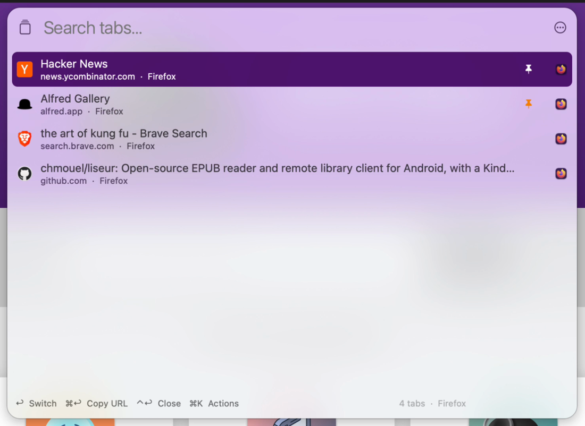

## Setup

Install the Vicinae browser extension in [Firefox](https://addons.mozilla.org/firefox/addon/vicinae/) or in [Chrome, Brave and other Chromium browsers](https://chromewebstore.google.com/detail/vicinae-integration/kcmipingpfbohfjckomimmahknoddnke), then connect it via the `tabs:setup` keyword. The extension picks up the connection within a minute.

## Usage

Search the tabs of every connected browser via the `tabs` keyword.

* <kbd>↩</kbd> Switch to the tab.
* <kbd>⌘</kbd><kbd>↩</kbd> Copy the URL.
* <kbd>⌃</kbd><kbd>↩</kbd> Close the tab and keep the list open.
* <kbd>⌘</kbd><kbd>K</kbd> Show more actions: copy the title or a Markdown link.

Alternatively, browse the same tabs as regular Alfred results via the `tabl` keyword.

Configure the Hotkey for faster triggering.
